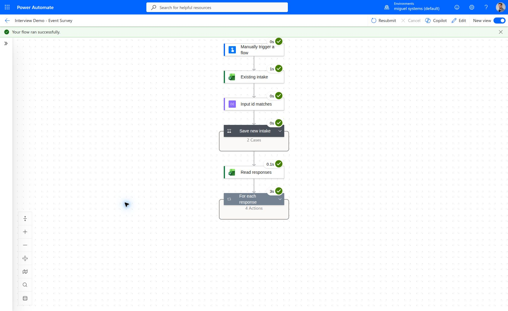

# Event survey routing

Collect synthetic survey input in an Excel table, validate ratings, flag keyword matches and write review receipts to SharePoint.

**Synthetic reconstruction by Miguel Rodriguez, November 2026.** This recreates an owner-described historical business process with new fixtures and documented assumptions. It contains no employer records, PHI, credentials or real recipient list.

The flow was imported into Microsoft Power Automate and its baseline run succeeded. The implementation uses SharePoint and Excel Online (Business). It uses a manual input form for practice; this is not a Power Apps canvas application. Native receipt reconciliation and further test status are recorded in [validation](docs/VALIDATION.md).

This screenshot is an actual Microsoft run view. It is not a locally rendered mockup.

## Run it

1. Read [setup and import instructions](docs/SETUP.md).
2. Configure your private test site and connector bindings.
3. Run with blank optional inputs to process the seeded fixtures.
4. Compare receipts with [expected results](validation/expected-baseline.json).
5. Use the [walkthrough](docs/WALKTHROUGH.md) to explain the rules and limitations.

See [architecture](docs/ARCHITECTURE.md), [validation](docs/VALIDATION.md), and [historical attribution](docs/HISTORY.md). The import ZIP is a sanitized template: configure it before import. Original owner-tenant exports are retained privately outside this repository.

## Scope and limits

S003 says “No complaint from me” and deliberately triggers a false positive. This is substring matching, not sentiment analysis. S004 has an invalid rating. The native Power Query preview evaluated four rows, but a usable Power BI report and refresh were not verified: the service reported a regional Pro-workspace limitation.

No paid trial or premium connector was activated for this test. The test account showed Power Automate for Office 365 and Power Automate Free. Your own tenant entitlements and policies must support these connectors. No external reviewer was invited; requester/certifier permission separation was not tested.

## Files

- `flow/`: action graph, manual-trigger schema and portable import template.
- `fixtures/`: synthetic Excel tables.
- `scripts/`: package configuration and receipt reconciliation.
- `validation/`: expected outcomes and captured native outputs.
- `docs/screenshots/`: actual native evidence, captioned in the documentation.
