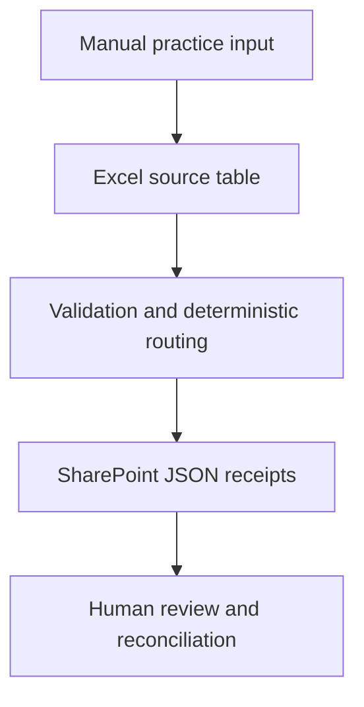

# Architecture

Collect synthetic survey input in an Excel table, validate ratings, flag keyword matches and write review receipts to SharePoint.

S003 says “No complaint from me” and deliberately triggers a false positive. This is substring matching, not sentiment analysis. S004 has an invalid rating. The native Power Query preview evaluated four rows, but a usable Power BI report and refresh were not verified: the service reported a regional Pro-workspace limitation.

The manual input schema and complete action graph are in `flow/`. Only standard SharePoint and Excel actions carry out service operations. There are no HTTP or email-send actions. Conditions and loop operations use Power Automate expressions.

Intake and certifier responses are separate records. Certification joins on RequestId + Revision, suppresses stale revisions, and flags duplicate or ambiguous records. A one-account practice environment does not prove that reviewers and submitters have separate permissions. A production solution needs explicit access design, ownership, retention, error handling and a transaction-safe uniqueness strategy.

The current import preserves the seed connection configuration as invoker connections: the runner supplies authorized SharePoint/Excel connections. Do not broaden access to make a demo run.
