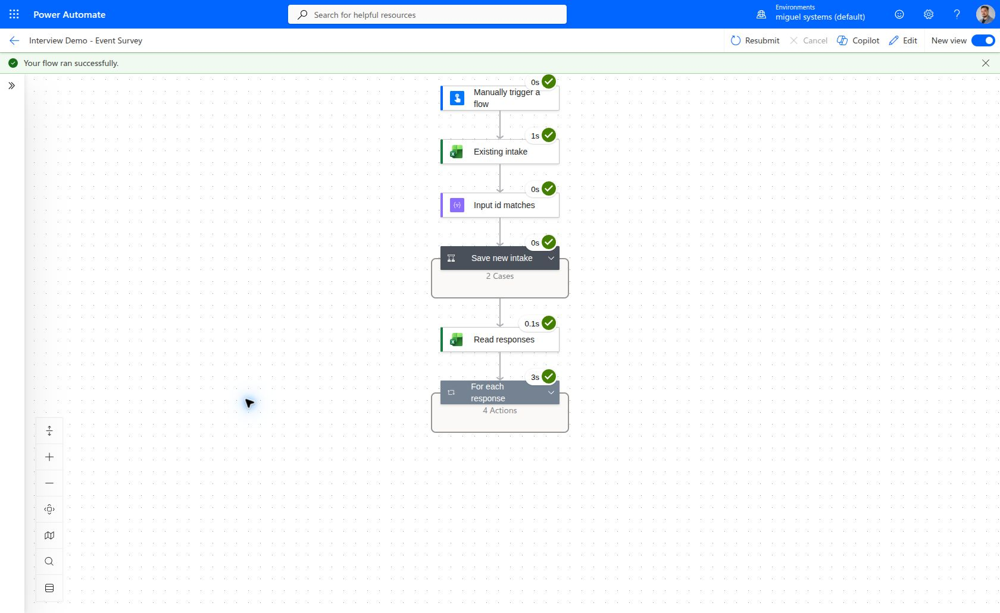
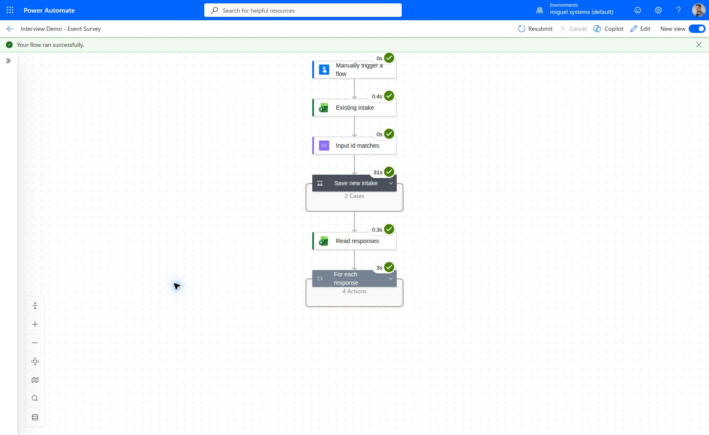

# Validation record

Test date: November 17, 2026, America/Chicago (November 18 UTC). Synthetic private tenant practice.

- Native package import: successful.
- Baseline flow run: **Succeeded**.
- Run identifier: `08584066440986345705893332280CU17`.
- Real emails: **0**.
- Native output reconciliation: see `validation/baseline/`, `expected-baseline.json`, and `python3 scripts/verify_receipts.py`.
- Further checks: new S005 input completed in the native flow.

Actual Power Automate run trace, captured after the service reported success. File values are independently reconciled because successful execution alone does not prove correct business outcomes.

S003 says “No complaint from me” and deliberately triggers a false positive. This is substring matching, not sentiment analysis. S004 has an invalid rating. The native Power Query preview evaluated four rows, but a usable Power BI report and refresh were not verified: the service reported a regional Pro-workspace limitation.

Local reference simulation separately passed 17 checks across the original suite. That result is not the native Microsoft run result. Native screenshots and JSON previews are separate evidence. The sanitized portable configuration has not been tested in a second tenant.

## Native manual-form intake

S005 was added through the native trigger form and routed to CriticalFeedbackReview. Captured receipt: `validation/intake/`.

